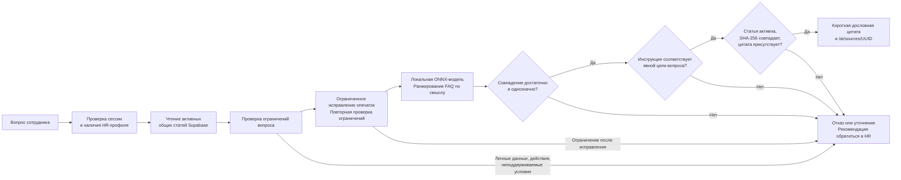

# Архитектура PostTech и локальной Jana

Ветка Integration объединяет React-портал, FastAPI, Supabase и локальный
FAQ-поиск Jana. ИИ работает на CPU сервера, возвращает подготовленную цитату
с источником и не выполняет кадровые действия. Схема отражает реализацию
на 17 октября 2026 года. Пунктиром отмечены **будущие**, ещё не подключённые
интеграции с 1С:ЗУП и Documentolog.

## Общая схема

Файл для презентации: [схема SVG](architecture.svg) или [схема PNG](architecture.png).
Эти изображения показывают те же границы в компактном виде.

## Как Jana формирует ответ

Пороги сейчас: близость не ниже `0.72`, отрыв от следующего кандидата не меньше
`0.045`. Это значения сходства, а не проценты уверенности. Файл модели и
токенизатор закреплены версией и SHA-256 в `app/services/local_embeddings.py`.
Первичная загрузка выполняется отдельной командой; при запросе модель сама
ничего не скачивает. Нет автоматического переключения на OpenAI.
Фразы кодируются по одной: добавление или перестановка FAQ-примеров не влияет
на векторы прежних фраз через padding и квантование соседей по batch.

Ответ содержит `answer`, `sources`, `grounded`, `escalation_suggested`, `mode`.
Нажатие на источник вызывает `GET /api/v1/ai/sources/{id}` с токеном пользователя.
Этот маршрут читает статью напрямую после авторизации и не запускает модель.
При недоступной модели или базе API возвращает 503 — техническую ошибку,
которую интерфейс отличает от обычного отказа.

`grounded=true` подтверждает совпадение цитаты с источником; это не гарантия,
что модель правильно поняла вопрос. Актуальные результаты приведены
в [отчёте по девяти наборам](jana-release-report.md), прежние итерации —
в [истории acceptance v1](jana-acceptance-report.md).

## Границы доступа

- Браузер обращается к FastAPI. Серверный ключ Supabase хранится только на
  бэкенде; браузер получает пользовательские access/refresh-токены.
- FastAPI проверяет сессию Supabase Auth и находит роль в кадровом профиле.
  Роль из текста вопроса или тела запроса не принимается как разрешение.
- Профили и заявки: сотруднику доступны свои данные, руководителю — также
  данные прямых подчинённых, HR — данные в рамках административной роли.
  Официальные поля профиля доступны пользователю только для чтения.
- RLS включена; серверный ключ её обходит. Поэтому проверки доступа в API и
  транзакционных RPC обязательны. Браузер работает через защищённые API-маршруты.
- Jana читает только `knowledge_articles`. Она не запрашивает персональные
  зарплаты, профили или заявки, не меняет записи и не имеет памяти диалога.
  Код авторизации перед обращением к Jana отдельно читает профиль для проверки
  доступа; его содержимое в поисковую модель не передаётся.
- Все статьи текущего FAQ доступны любому вошедшему сотруднику с HR-профилем.
  Отдельного разграничения статей по ролям сейчас нет: закрытые документы HR
  нельзя загружать сюда без расширения модели доступа и фильтрации обоих
  маршрутов — вопроса и чтения источника.

Supabase остаётся облачной зависимостью для авторизации и данных. Локальная
модель не делает весь портал автономным. В демонстрации используются
вымышленные сотрудники и учебные статьи, явно отмеченные как демо.

## Будущие интеграции

Это проект границ интеграции, а не уже реализованные подключения.

| Система | Направление и назначение | Что нужно предусмотреть при реализации |
| --- | --- | --- |
| 1С:ЗУП | Адаптер читает официальные сведения, руководителя и остаток отпуска; обновляет кадровый снимок в Postgres. | Устойчивое сопоставление внешнего сотрудника с профилем; время последней синхронизации; журнал ошибок; повторная загрузка без дублей. Изменение пользователем официальных полей остаётся закрытым. |
| Documentolog | HR-сервис передаёт согласованную заявку через адаптер, получает внешний ID документа и затем его статус. | Отдельные внутренний статус заявки и внешний статус документа; очередь повторов; идемпотентность; проверка подлинности входящих событий; история и уведомления после подтверждённого изменения. |

Синхронизация выполняется серверными адаптерами. Ключи внешних систем не
передаются браузеру или модели. Отказ внешней системы должен сохранять
согласованную заявку и показывать состояние синхронизации, а не терять данные.
Протоколы 1С и Documentolog нужно уточнить по документации доступных команде
инсталляций; конкретные внешние URL и форматы здесь не выдумываются.

Сейчас заявки создаются и рассматриваются транзакционными RPC
`create_hr_request` / `review_hr_request`: заявка, история и уведомления
сохраняются вместе. Аналогичной атомарности для операций Academy пока нет.
Файл календаря формируется из дат одобренной заявки; прямого API Google и
автоматической синхронизации календаря нет.

## Короткое объяснение для защиты

«Сотрудник работает в одном портале. Сервер проверяет его роль и предоставляет
только разрешённые данные. Jana ищет по смыслу в подготовленных FAQ и выдаёт
цитату из проверенного источника. Если ответа нет или источник изменился,
помощник отказывается отвечать. Модель работает локально без платы за токены.
Для будущих 1С:ЗУП и Documentolog предусмотрены серверные адаптеры; сейчас
они заменены тестовыми данными и обозначены на схеме как дальнейшее развитие».
