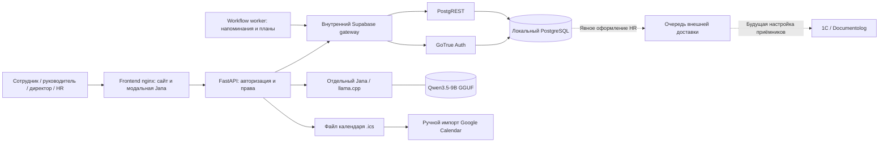

# Архитектура общего PostTech

## Границы данных

Снаружи открыт только сайт на 127.0.0.1:8000. Модель, Auth, REST и база работают в закрытой Docker-сети. Для Docker разрешён ровно `http://jana-reader:8081` с явным opt-in; native-режим по умолчанию допускает только loopback. Внешний LLM и облачный fallback не используются.

`/ai/ask` передаёт модели вопрос и полный допустимый снимок общих статей. Сервер проверяет идентификаторы и точное содержание цитат, повторно проверяет снимок после генерации и возвращает ссылки с версией. Черновики, архив, непроверенные и просроченные материалы исключаются. В модель не передаются персональные профили, заявки и результаты обучения.

`/workspace/summary` — отдельная программная сводка текущих доступных записей. Сотрудник видит своё, руководитель и директор — данные в рамках непосредственного подчинения и назначенного согласования, HR — разрешённые административные данные. Кнопка сводки внутри чата не вызывает LLM.

## Транзакции

Первый согласующий фиксируется при отправке; временное замещение не расширяет доступ к кадровым профилям. Первое одобрение переводит заявку в pending_hr, HR принимает окончательное решение. Резервы, однократное списание отпуска, история и уведомления изменяются атомарно. После одобрения отдельно существует стадия оформления HR; внешние события создаются при явной отправке настроенным приёмникам. Готовый документ подтверждается отдельным номером, а не только доставкой события.

Миграции применяются в порядке 17 файлов из `database/migration-plan.json`. Docker bootstrap проверяет фиксированную локальную базу и marker, записывает checksum каждого SQL. Существующая общая Supabase требует отдельного плана перехода.

## Проверка

Unit/API тесты дополнены настоящими SQL-транзакциями в одноразовых локальных базах. Управляемые браузерные тесты отдельно проверяют интерфейс и ошибки. Docker smoke использует настоящие Auth, REST, базу, frontend и локальную модель; его результаты не заменяют независимую проверку качества понимания вопросов. Точные результаты и ограничения — в [отчёте](team-integration-report.md).

Исторические `architecture.svg/png` относятся к прежним версиям; актуальная схема приведена выше.
