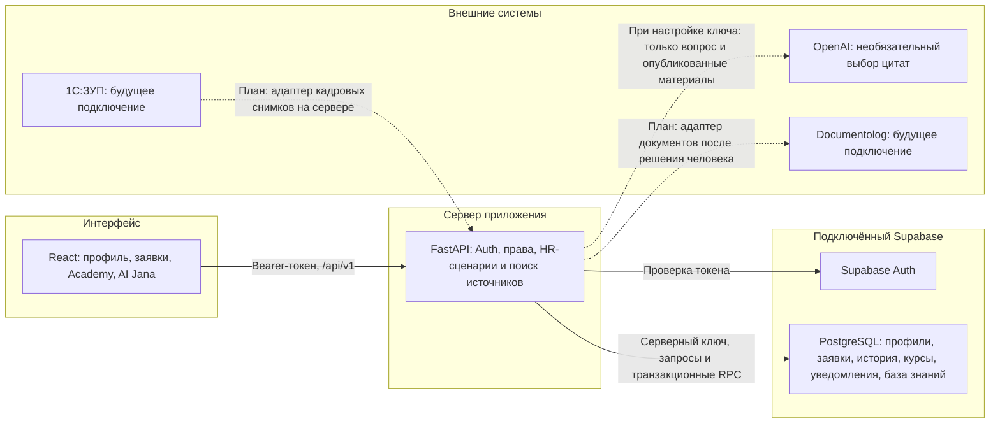

# Архитектура PostTech / JanaМен

Прототип объединяет профиль, заявки, обучение, уведомления и HR-помощь в одном React-портале. FastAPI проверяет пользователя и его кадровую роль; Supabase хранит Auth-аккаунты и данные. Официальные поля профиля доступны сотруднику только для чтения.

Пунктир у 1С:ЗУП и Documentolog обозначает проектируемые соединения: работающих адаптеров нет. Подключение OpenAI необязательно; без него Jana возвращает явно обозначенные фрагменты базы знаний. Внешний LLM не нужен для входа, заявок, обучения или уведомлений.

## Границы доверия

1. Браузер получает пользовательскую сессию. Серверный Supabase-ключ и OpenAI-ключ остаются на сервере; `.env` и `.local/` исключены из Git и Docker-контекста.
2. На каждом защищённом запросе FastAPI проверяет токен через Supabase Auth. Затем находит `employee_profiles.auth_user_id` и получает роль из кадрового профиля. Роль в форме, заголовке или пользовательских метаданных не даёт дополнительных прав. Аккаунт без связанного профиля получает `403`.
3. API ограничивает чтение по роли и владельцу. RLS включена; у `anon` и `authenticated` нет разрешающих политик прямого чтения. Серверный `service_role` обходит RLS, поэтому проверка прав в API обязательна. Нельзя выдавать этот ключ браузеру.
4. Изменения заявок и обучения выполняются через SQL RPC. Они повторно проверяют действующее лицо и сохраняют связанные события и уведомления одной транзакцией. Идентификатор действующего сотрудника сервер берёт из сессии.
5. Профиль сотрудника может показывать имя руководителя. Это не открывает сотруднику кадровую карточку руководителя; `auth_user_id` не возвращается в публичной карточке.

## Данные и сценарии

| Контур | Хранение и ответственность |
| --- | --- |
| Идентичность | `auth.users` связывается один-к-одному с `employee_profiles`. Регистрация не создаёт кадровую роль. |
| Профиль | Организация, должность, подразделение, руководитель, дата найма и остаток отпуска. В тестовых профилях `external_source` явно указывает синтетический источник. |
| Заявки | `hr_requests` + `request_events` + `notifications`. Создание и решение атомарны; ключ повторной отправки защищает от дубликатов. |
| Маршрут заявки | Расширение `0003_request_lifecycle.sql` сохраняет согласующих на момент создания. Личная заявка не может быть согласована самим автором. Права на старую заявку определяются сохранённым маршрутом, права на кадровый профиль — текущей связью команды. |
| Обучение | `courses`, `course_assignments`, расширение `course_attempts` из `0004_academy_workflow.sql`. Правильные ответы остаются на сервере; API получает ответы сотрудника и возвращает результат. |
| AI Jana | Только активные `knowledge_articles`. Это общая опубликованная база для всех трёх ролей; приватные статьи для отдельных ролей пока не поддерживаются. |

Миграции применяются отдельно и в порядке номеров. Наличие файла в репозитории не означает, что он применён в конкретном Supabase-проекте. Нельзя повторно запускать ранние миграции поверх существующей схемы. Результаты фактической проверки окружения находятся в [журнале проверки](live-verification.md).

## Проверяемый ответ Jana

Jana не читает профили, зарплаты, заявки других работников или результаты обучения. Поиск ограничен общей опубликованной базой. Ответ содержит идентификаторы найденных источников; авторизованный пользователь может открыть полный активный материал через `GET /api/v1/ai/sources/{id}`.

При подключённом OpenAI модель выбирает точные цитаты и сообщает, хватает ли материала. Сервер проверяет наличие каждой цитаты в переданном источнике и существование номера источника. Свободный текст модели, придуманные цитаты, некорректный ответ или отказ модели не выдаются за подтверждённый ответ. При недоступной модели используется явно подписанный поиск фрагментов; совпадения одной темы недостаточно, если вопрос содержит неподтверждённые условия.

Запросы на кадровое решение и распространённые попытки подменить инструкции отклоняются. Фильтр таких формулировок — дополнительная эвристика; основная граница — отсутствие доступа к персональным таблицам и инструментам изменений, проверка точных цитат и отсутствие свободной генерации фактов. Jana не утверждает отпуск, не увольняет, не рассчитывает выплаты и не придумывает кадровые нормативы. При отсутствии подтверждения предлагает обратиться в HR.

## Будущие интеграции

**1С:ЗУП.** Сейчас используются фиктивные кадровые снимки. Будущий серверный адаптер должен сопоставлять внешние идентификаторы сотрудника, нормализовать поля и обновлять только кадровую проекцию. Потребуются журнал синхронизации, контроль версии/времени снимка и отображение свежести данных. Официальная система остаётся источником кадровых сведений; пользовательское редактирование этих полей не появляется.

**Documentolog.** Сейчас согласование фиксирует решение человека, историю и уведомление. Оно не создаёт подписанный документ, не списывает дни и не меняет 1С. Будущий адаптер получает событие подтверждённого решения, создаёт документ с внешним идентификатором и возвращает статус подписания. Для гарантированной доставки потребуется транзакционный outbox с идемпотентным обработчиком; этот механизм пока не реализован.

Для MVP достаточно модульного приложения и SQL-транзакций. Отдельные микросервисы, очередь сообщений и векторная база не требуются для текущего объёма демонстрационных данных.
