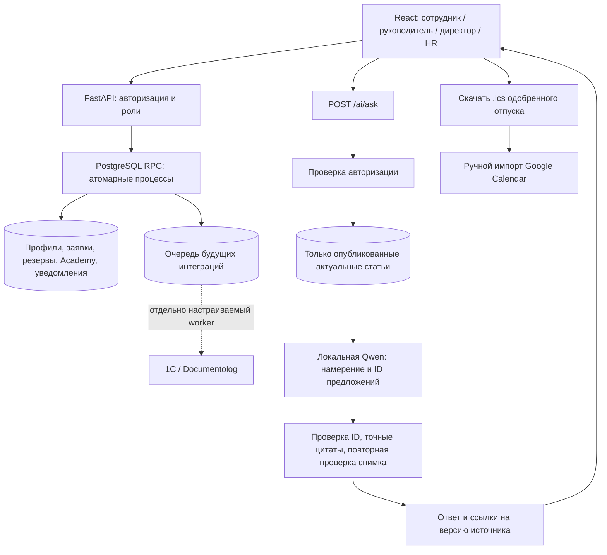

# Архитектура объединённого PostTech

## Согласование и отпуск

При наличии руководителя `pending → pending_hr` выполняет назначенный руководитель, директор или допустимый заместитель. HR принимает окончательное решение. Без руководителя HR рассматривает заявку сразу. Пользователь не согласует собственную заявку; разрешения проверяются внутри SQL, а не только интерфейсом.

Ожидающий отпуск резервирует календарные дни. После финального `approved` официальный остаток уменьшается один раз, соответствующий hold получает `reconciled`; повторное подтверждение не списывает дни снова. Отказ и отмена ожидающей заявки освобождают резерв. История, уведомления, изменения статуса и баланс согласованы транзакционно.

## Граница Jana

У reader нет доступа к профилям, заявкам, ключам Supabase, действиям или SQL. Он получает только вопрос и общие статьи. Сервер проверяет выбранные фрагменты; всё содержимое базы не обрезается при нехватке контекста. Ссылки подписаны хешем снимка: изменённый источник возвращает 409, снятый с публикации — 404. Правильность цитаты не гарантирует правильность её выбора.

## Локальные проверки

Отдельный PostgreSQL на loopback, базы `posttech_test_*`. Bootstrap только по `database/migration-plan.json`; это не migration upgrade существующего Supabase. HTTP+SQL тесты подменяют Auth и PostgREST transport, но выполняют настоящие SQL функции. Browser E2E используют управляемый mock API. Отдельный прогон Jana использует настоящую локальную модель и JSON статьи.

Общая Supabase не подключалась и не изменялась. Реальный Supabase Auth и обновление общей схемы требуют отдельной последующей проверки. Старые architecture.svg/png, если присутствуют, отражают предыдущую версию и не являются схемой этой сборки.
