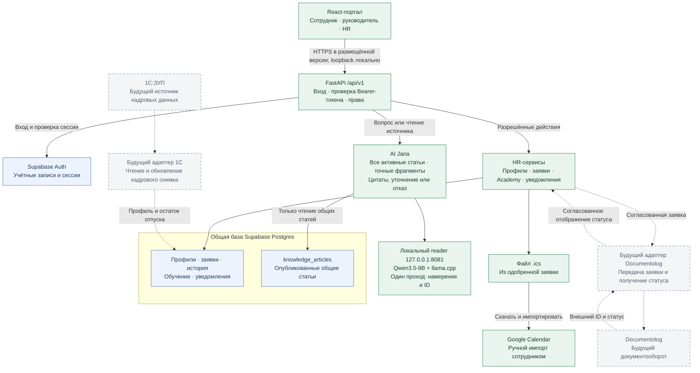
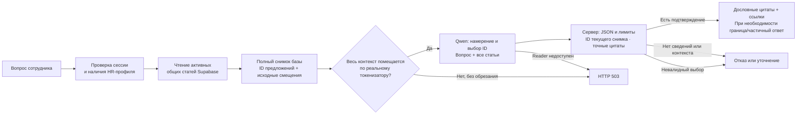

# Архитектура PostTech и локальной Jana

Ветка Integration объединяет React-портал, FastAPI, Supabase и локальный
читатель базы Jana на локальном Qwen3.5-9B через llama.cpp. Модель выбирает
предложения из всех опубликованных статей; сервер выдаёт дословные цитаты
и не выполняет кадровые действия. Схема отражает реализацию
на 17 октября 2026 года. Пунктиром отмечены **будущие**, ещё не подключённые
интеграции с 1С:ЗУП и Documentolog.

## Общая схема

Mermaid-схемы в этом документе показывают текущий механизм. Прежние экспорты
[SVG](architecture.svg) и [PNG](architecture.png) сохранены как иллюстрации старого
FAQ-поиска и ещё не обновлены; для защиты новой версии используйте схемы здесь.

## Как Jana формирует ответ

Новая статья попадает в следующий снимок без FAQ-карточки и списка ожидаемых
вопросов. Модель не учится на вопросах тестирования. ID фрагментов зависят от
полного содержания статьи; изменение условий делает прежние ID недействительными.
Выход единственного прохода модели содержит краткую внутреннюю формулировку запроса,
намерение, ID и вид уточнения. Сервер проверяет JSON, лимиты и соответствие
выбранных ID текущему снимку опубликованных источников. Фактические фразы,
ссылки и действия она не формирует. Несколько выбранных фрагментов одной статьи
объединяются с промежуточным контекстом в точную подстроку источника.

Qwen и llama.cpp закреплены версиями и SHA-256 в `knowledge_base/reader-model.json`.
Подготовка: `scripts.prepare_jana_reader`; запуск: `scripts/start_jana_reader.ps1`.
При вопросе файлы не скачиваются, переключения на OpenAI нет. Основное размещение —
нативные Windows-процессы. Существующий Docker Compose не запускает reader;
loopback контейнера и loopback Windows-хоста различаются.

Текущая модель — Qwen3.5-9B Q4_K_M (GGUF-конверсия bartowski, около 6,17 ГБ).
Под конфигурацию 16 ГБ RAM / 4 ГБ VRAM манифест задаёт 20 слоёв на GPU,
остальные в RAM/CPU, и контекст 8192 токена. Параметры загрузки не являются
результатом оценки смыслового качества или гарантией скорости.

Все активные статьи читаются целиком до заданных бюджетов: 100 статей, 20 000 символов
в одной, 48 000 суммарно с заголовками. Модель дополнительно считает реальные
токены полного запроса. Контекст не обрезается; превышение даёт 503.
При дальнейшем росте базы нужен отдельный проверенный поиск. Reader обрабатывает
один запрос одновременно; массовая нагрузка пока не проверена.

Ответ содержит `answer`, `sources`, `grounded`, `escalation_suggested`, `mode`.
Нажатие на источник вызывает `GET /api/v1/ai/sources/{id}` с токеном пользователя.
Этот маршрут читает статью напрямую после авторизации и не запускает модель.
При недоступной модели или базе API возвращает 503 — техническую ошибку,
которую интерфейс отличает от обычного отказа.

`grounded=true` подтверждает совпадение цитаты с источником; это не гарантия,
что модель правильно поняла вопрос. Семантической самопроверки вторым проходом
в рабочем запросе нет. Новый [runner](../scripts/evaluate_jana_reader.py) сохраняет
ответы и проверяет подлинность цитат; смысл оценивается отдельно по заранее
зафиксированным фактам. [Девять прежних наборов](jana-release-report.md)
и [acceptance v1](jana-acceptance-report.md) описывают исторический FAQ-механизм.

## Границы доступа

- Браузер обращается к FastAPI. Серверный ключ Supabase хранится только на
  бэкенде; браузер получает пользовательские access/refresh-токены.
- FastAPI проверяет сессию Supabase Auth и находит роль в кадровом профиле.
  Роль из текста вопроса или тела запроса не принимается как разрешение.
- Профили и заявки: сотруднику доступны свои данные, руководителю — также
  данные прямых подчинённых, HR — данные в рамках административной роли.
  Официальные поля профиля доступны пользователю только для чтения.
- RLS включена; серверный ключ её обходит. Поэтому проверки доступа в API и
  транзакционных RPC обязательны. Браузер работает через защищённые API-маршруты.
- Jana читает только `knowledge_articles`. Она не запрашивает персональные
  зарплаты, профили или заявки, не меняет записи и не имеет памяти диалога.
  Код авторизации перед обращением к Jana отдельно читает профиль для проверки
  доступа; его содержимое в поисковую модель не передаётся.
- Все общие статьи доступны любому вошедшему сотруднику с HR-профилем.
  Отдельного разграничения статей по ролям сейчас нет: закрытые документы HR
  нельзя загружать сюда без расширения модели доступа и фильтрации обоих
  маршрутов — вопроса и чтения источника.

Supabase остаётся облачной зависимостью для авторизации и данных. Локальная
модель не делает весь портал автономным. В демонстрации используются
вымышленные сотрудники и учебные статьи, явно отмеченные как демо.

## Будущие интеграции

Это проект границ интеграции, а не уже реализованные подключения.

| Система | Направление и назначение | Что нужно предусмотреть при реализации |
| --- | --- | --- |
| 1С:ЗУП | Адаптер читает официальные сведения, руководителя и остаток отпуска; обновляет кадровый снимок в Postgres. | Устойчивое сопоставление внешнего сотрудника с профилем; время последней синхронизации; журнал ошибок; повторная загрузка без дублей. Изменение пользователем официальных полей остаётся закрытым. |
| Documentolog | HR-сервис передаёт согласованную заявку через адаптер, получает внешний ID документа и затем его статус. | Отдельные внутренний статус заявки и внешний статус документа; очередь повторов; идемпотентность; проверка подлинности входящих событий; история и уведомления после подтверждённого изменения. |

Синхронизация выполняется серверными адаптерами. Ключи внешних систем не
передаются браузеру или модели. Отказ внешней системы должен сохранять
согласованную заявку и показывать состояние синхронизации, а не терять данные.
Протоколы 1С и Documentolog нужно уточнить по документации доступных команде
инсталляций; конкретные внешние URL и форматы здесь не выдумываются.

Сейчас заявки создаются и рассматриваются транзакционными RPC
`create_hr_request` / `review_hr_request`: заявка, история и уведомления
сохраняются вместе. Аналогичной атомарности для операций Academy пока нет.
Файл календаря формируется из дат одобренной заявки; прямого API Google и
автоматической синхронизации календаря нет.

## Короткое объяснение для защиты

«Сотрудник работает в одном портале. Сервер проверяет его роль и предоставляет
только разрешённые данные. Jana читает вопрос и все опубликованные статьи,
за один проход выбирает подтверждающие предложения. Сервер проверяет источники
и возвращает точные цитаты со ссылками. При недостатке сведений Jana отказывает или просит
уточнение; кадровые действия не выполняет. Модель работает локально без платы за токены,
но качество понимания проверяется отдельно и не гарантируется одним наличием цитаты.
Для будущих 1С:ЗУП и Documentolog предусмотрены серверные адаптеры; сейчас
они заменены тестовыми данными и обозначены на схеме как дальнейшее развитие».
