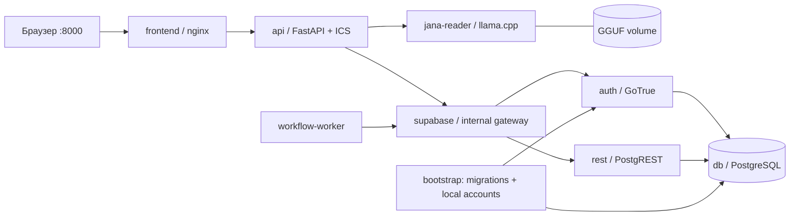

# Полностью локальный Docker

Стек запускает frontend, API, PostgreSQL, Supabase Auth (GoTrue), PostgREST,
внутренний gateway, обработчик HR workflows и отдельный сервер Jana. Общая
Supabase и платные API не используются. Календарь — штатный endpoint API:
окончательно одобренный отпуск скачивается как `.ics` и импортируется в Google
Calendar вручную. Общий файл поддерживает выбранный месяц или все разрешённые пользователю отпуска; права и окончательное согласование проверяет backend. Отдельный календарный сервис для этого не нужен.

## Запуск в Windows

Нужен работающий Docker Desktop с Linux containers. Запускать из этой ветки:

```powershell
powershell -ExecutionPolicy Bypass -File scripts/start_docker.ps1
```

Если модель уже скачана, передайте каталог с GGUF, чтобы не загружать 6.17 GB снова:

```powershell
powershell -ExecutionPolicy Bypass -File scripts/start_docker.ps1 -ModelDirectory C:\Posttech\.models\reader
```

При доступной NVIDIA GPU добавьте `-Gpu`. Это включает
`compose.gpu.yaml`: тот же release `server-cuda-b11669`, та же модель и перенос
20 слоёв на GPU. Базовый Compose остаётся переносимым CPU-вариантом.

```powershell
powershell -ExecutionPolicy Bypass -File scripts/start_docker.ps1 -Gpu -ModelDirectory C:\Posttech\.models\reader
```

Для ручных команд GPU-стека каждый раз используйте
`docker compose --env-file .local/docker.env -f compose.yaml -f compose.gpu.yaml ...`.

Скрипт генерирует `.local/docker.env`, собирает образы, проверяет модель и ждёт
готовности контейнеров. Python/Node на компьютере не требуются. Повторный запуск
сохраняет существующие локальные ключи, аккаунты, данные и модель.
Вход и обычные HR-функции работают во время прогрева модели; запрос Jana до
готовности её контейнера может вернуть временную недоступность.

Открыть [http://127.0.0.1:8000](http://127.0.0.1:8000). Локальные аккаунты:

| Email | Роль |
| --- | --- |
| `employee@posttech.demo` | Сотрудник |
| `manager@posttech.demo` | Руководитель |
| `director@posttech.demo` | Директор |
| `hr@posttech.demo` | HR |

Пароль хранится в `POSTTECH_DEMO_PASSWORD` внутри `.local/docker.env`.
Это отдельные локальные аккаунты. Файл с паролями и ключами не коммитить и не
отправлять другим участникам; у каждого компьютера создаётся свой.

## Команды вручную

```powershell
# Генерация секретов в контейнере; существующий файл сохраняется.
docker run --rm --volume "${PWD}:/workspace" --workdir /workspace python:3.12-slim python scripts/prepare_docker.py
docker compose --env-file .local/docker.env build

# Необязательно: импорт уже имеющегося GGUF после проверки SHA256.
docker compose --env-file .local/docker.env run --rm --no-deps --volume "C:\Posttech\.models\reader:/model-source:ro" model-init --source /model-source

docker compose --env-file .local/docker.env up --detach --wait --wait-timeout 1800
docker compose --env-file .local/docker.env ps
docker compose --env-file .local/docker.env logs --tail 100 api auth bootstrap jana-reader workflow-worker
docker compose --env-file .local/docker.env down
```

Всегда передавайте `--env-file .local/docker.env`; общий `.env` предназначен для
другого способа запуска. `down` сохраняет volumes. Удаление volumes удалит
локальную базу и/или модель; обычный перезапуск этого не требует. Не удаляйте
`docker.env`, пока используете существующий том базы: новые секреты не заменяют
пароли уже созданных аккаунтов и PostgreSQL.

## Как устроен запуск



Только frontend публикует порт, привязанный к `127.0.0.1`, и подключён к отдельной
обычной сети `edge`: в Docker Desktop одна закрытая сеть не публикует host-порт.
Он также подключён к `private`, чтобы передавать запросы API. База, API, Auth,
REST и сервер модели подключены только к закрытой сети. Одноразовый `model-init` имеет
доступ к сети для загрузки; во время ответа Jana внешнего соединения нет.
API разрешает ровно `http://jana-reader:8081` только при
`JANA_READER_ALLOW_DOCKER_HOST=true`; обычный запуск сохраняет loopback-ограничение.

GoTrue самостоятельно создаёт свой Auth schema. Затем `bootstrap` проверяет
фиксированную базу `db:5432/posttech_local` и её Docker marker, применяет полный
`database/migration-plan.json`, создаёт демо-пользователей через Auth admin API и
загружает seed. Для каждого SQL-файла сохраняется checksum: уже применённый файл
нельзя молча заменить другим. Изменения схемы добавляются новой миграцией.
Обработка напоминаний выполняется отдельным `workflow-worker` каждые 60 секунд.

## Модель и ограничения

Используется тот же Qwen3.5-9B Q4_K_M из `knowledge_base/reader-model.json`:
6 169 341 984 байта, фиксированная revision и SHA256. Сервер закреплён на
`llama.cpp server-b11669`. CPU-режим, один запрос одновременно, контекст 8192,
4 потока, небольшие batch/ubatch. Модель не заменяется меньшей автоматически.

На Docker с 8 GB RAM памяти может не хватить для модели и остальных сервисов.
Освободите память других приложений; предпочтительно выделить Docker 10–12 GB,
если у компьютера есть столько свободной памяти. Первый ответ на CPU может
занять несколько минут. API ждёт до 300 секунд и возвращает честную ошибку
недоступности при превышении времени. Сам факт готовности `/health` не означает,
что модель успеет ответить на любой вопрос.

Для локального демо включено автоматическое подтверждение email. Внешняя почта,
восстановление пароля через настоящий почтовый ящик, внешние HR-системы и
синхронизация Google Calendar не подключены. Это изолированный стенд для
разработки и демонстрации, не производственная конфигурация Supabase.

Проверенные источники образов: [официальный Compose Supabase](https://github.com/supabase/supabase/blob/master/docker/docker-compose.yml),
[PostgreSQL](https://github.com/docker-library/official-images/blob/master/library/postgres),
[nginx](https://github.com/docker-library/official-images/blob/master/library/nginx),
[Docker llama.cpp](https://github.com/ggml-org/llama.cpp/blob/master/docs/docker.md).
Теги GoTrue `v2.197.0`, PostgREST `v14.18`, PostgreSQL `17.11-alpine3.23`,
nginx `1.30.6-alpine` и llama.cpp `server-b11669` проверены в registry.
