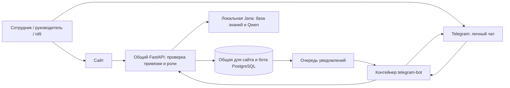

# Telegram и портал PostTech

Для привязки аккаунтов, репетиции на 10 минут и временной защиты от сна смотрите
[инструкцию показа и постоянной работы](telegram-demo.md).

Бот — ещё один интерфейс к существующему API. Он использует те же аккаунты,
заявки, уведомления, назначенные курсы и локальную Jana. Отдельной копии
HR-данных или отдельной ИИ-модели у бота нет. Разрешения проверяет сервер при
каждом действии, включая действия по кнопкам из старых сообщений.



## Возможности

| Функция | В Telegram | Связь с сайтом |
| --- | --- | --- |
| Аккаунт | Привязка из настроек сайта одноразовой ссылкой | Тот же HR-профиль и текущая роль |
| Профиль | Должность, отдел, руководитель, остаток отпуска | Актуальные данные API |
| Заявки | Отпуск/аванс, подтверждение, статус, история, отзыв | Создаются и меняются те же записи |
| Согласование | Руководитель/директор/HR по существующим правам | Сохраняется двухэтапное согласование |
| Jana | Вопросы текстом, ответы и открытие источников | Тот же `/ai/ask` и выбранный на сервере провайдер Jana |
| Обучение | Назначенные курсы, материалы, уроки и тесты | Общий прогресс и результаты |
| Уведомления | Новые события после привязки; включение/отключение на сайте | Очередь на основе существующих уведомлений |
| HR | Обращение с подтверждением, просмотр ответа | Общее обращение с порталом |
| Календарь | Отдельный/общий `.ics` с проверкой прав | Согласованные отпуска из общей для сайта и бота базы |
| Остальные функции портала | «Открыть весь портал» внутри Telegram при настроенном HTTPS | Тот же адаптивный сайт с обычным входом |

Редакторы курсов, массовый импорт, администрирование сотрудников и другие
сложные экраны доступны через кнопку портала. Они не продублированы отдельными
чатовыми мастерами. В веб-интерфейсе внутри Telegram нужно войти обычным
способом в тот же аккаунт; автоматического входа через Telegram нет.

## 1. Создать бота

1. Открыть официальный [@BotFather](https://t.me/BotFather).
2. Отправить `/newbot`, задать название и свободное имя, заканчивающееся на `bot`.
3. Сохранить выданный токен в приватный файл. Не вставлять его в чат, исходники,
   презентацию или скриншоты.

Подключение использует [Telegram Bot API](https://core.telegram.org/bots/api)
и [одноразовую ссылку Start](https://core.telegram.org/bots/features#deep-linking).
Обычные сообщения бота не требуют платной ИИ-подписки. Серверу нужны интернет,
работающий backend и оборудование для локальной Jana. Хостинг и электричество
не становятся бесплатными от использования локальной модели.

## 2. Настроить приватный файл

Из корня этой рабочей копии:

```powershell
python scripts/prepare_telegram.py
```

Если на компьютере нет Python, используется контейнер:

```powershell
docker run --rm --volume "${PWD}:/workspace" --workdir /workspace python:3.12-slim python scripts/prepare_telegram.py
```

В `.local/telegram.env` заполнить `TELEGRAM_BOT_TOKEN=`. Секрет связи worker/API
генерируется автоматически. `TELEGRAM_BOT_USERNAME` заполняется после проверки
токена; секреты не печатаются. Существующий файл сохраняется.

```powershell
python scripts/prepare_telegram.py --check
```

Этот запрос проверяет `getMe` и ничего никому не отправляет. При необходимости
можно ввести токен скрыто в терминале: `python scripts/prepare_telegram.py --set-token`.

`PORTAL_PUBLIC_URL` необязателен для чата. Для открытия всего сайта внутри
Telegram укажите публичный HTTPS-адрес **именно этой установки**. `localhost`
на телефоне пользователя относится к его телефону, поэтому такая ссылка не
показывается. Адрес не выдаёт доступ к аккаунтам: сайт продолжает требовать вход.
Публикация сайта/HTTPS не выполняется скриптом автоматически.

## 3. Запустить

```powershell
powershell -ExecutionPolicy Bypass -File scripts/start_telegram.ps1
# Если используется существующий NVIDIA-вариант:
powershell -ExecutionPolicy Bypass -File scripts/start_telegram.ps1 -Gpu
```

Команда запускает локальный стек и отдельный контейнер `telegram-bot`.
Используются `.local/docker.env` и `.local/telegram.env`; общий облачный `.env`
не переносится в контейнеры. Миграция `0019_telegram.sql` применяется обычным
локальным bootstrap после предыдущих миграций. Облачная Supabase команды
этим запуском не изменяется.

Для ручных команд всегда сохранять **оба env-файла и оба compose-файла**:

```powershell
docker compose --env-file .local/docker.env --env-file .local/telegram.env -f compose.demo.yaml -f compose.telegram.yaml ps
docker compose --env-file .local/docker.env --env-file .local/telegram.env -f compose.demo.yaml -f compose.telegram.yaml logs --tail 50 telegram-bot
```

Для GPU дополнительно включить `-f compose.gpu.yaml`. Не публиковать вывод
`docker compose config`: он содержит раскрытые значения секретов.

В NVIDIA-варианте число слоёв на видеокарте можно задать переменной
`JANA_READER_GPU_LAYERS` в приватном `.local/docker.env` (по умолчанию `20`).
Это распределение той же модели Qwen3.5-9B между CPU и GPU: модель, полная база
знаний и проверка источников не меняются. Если видеопамять занята другими
приложениями, подходящее значение зависит от оборудования и нагрузки.
На проверенном GTX 1650 SUPER с 4 ГБ при `16` первый ответ прошёл за 221 секунду,
тогда как при `20` в той же сессии сработал таймаут 300 секунд. Это локальное
измерение, а не универсальная рекомендация: холодный запуск и первый вопрос
могут быть существенно медленнее последующих. После изменения настройку
применяют повторным запуском `scripts/start_telegram.ps1 -Gpu` и проверяют
известный ответ, его источник и отказ на неизвестный факт.

Worker использует long polling, поэтому входящий порт и публичный webhook
не нужны. Должен работать только **один** экземпляр worker для этого бота.
База, API и Jana остаются во внутренней сети; доступ к Telegram и бот-токен
есть только у worker. При выключении компьютера локальный бот недоступен.
Чтобы бот работал постоянно, весь стек размещается на постоянно работающем сервере.

## 4. Привязать аккаунт

1. Войти на сайте настоящим аккаунтом стенда, открыть «Настройки → Telegram».
2. Создать ссылку, открыть её в личном чате Telegram и нажать Start.
3. На сайте обновить статус. Код действует 10 минут и используется один раз.
4. Проверить `/menu` в боте. Связь можно удалить на сайте или командой `/stop`.

Если ссылка открыла только чат, в «Настройки → Telegram» скопируйте запасную
команду `/start <код>` и отправьте её целиком боту в личном чате. Один `/start`
без кода аккаунт не привяжет. Команда доступна вместе со свежей ссылкой и имеет
тот же срок действия; никому её не пересылайте. При ошибке буфера обмена команду
можно выделить и скопировать вручную из поля.

Подключение разрешает передачу выбранных данных и уведомлений в Telegram.
Это внешний канал: хотя модель Jana остаётся локальной, сообщения пользователя,
ответы и уведомления обрабатываются Telegram. Групповые чаты не поддерживаются,
пароль сайта в боте не запрашивается. После привязки отправляются только новые
уведомления; история не рассылается автоматически.

## Проверка совместной работы

1. Создать заявку в боте, подтвердить её; убедиться, что она появилась на сайте.
2. Связать отдельный аккаунт руководителя и согласовать заявку; затем завершить
   согласование под HR. Проверить статус на сайте и уведомление сотруднику.
3. Прочитать урок и пройти тест в боте; обновить страницу курса на сайте.
4. Спросить Jana известный факт, открыть источник; задать неизвестный вопрос.
5. Получить `.ics` согласованного отпуска. Импорт Google Calendar остаётся ручным.
6. Выключить уведомления и удалить привязку; проверить прекращение доступа.

Автоматические тесты используют имитацию Telegram, а миграции — отдельную
одноразовую PostgreSQL. Проверка через настоящий Telegram требует созданного
бота, сохранённого токена и привязанного тестового аккаунта.

Очередь сохраняется в базе, есть блокировки доставки, повторные попытки и
защита повторных бизнес-операций. Telegram не предоставляет транзакцию между
отправкой сообщения и подтверждением в нашей БД: при сбое в этот момент возможно
повторное уведомление. Не обещаем доставку «ровно один раз». Черновики диалогов
истекают через 15 минут и сбрасываются после перезапуска; подтверждённые заявки
и результаты обучения остаются в базе.


## Подключение к существующей установке main

`compose.yaml` сохраняет конфигурацию общего проекта. Overlay `compose.telegram.yaml` можно подключить к нему с приватным `.local/telegram.env`; bot и API получат общий worker-секрет. В этой базе должна быть применена миграция `0019_telegram.sql` после миграций main. Скрипт локального показа этого не делает: изменение общей Supabase — отдельное действие администратора. Не запускайте локальный bootstrap на общей базе.
